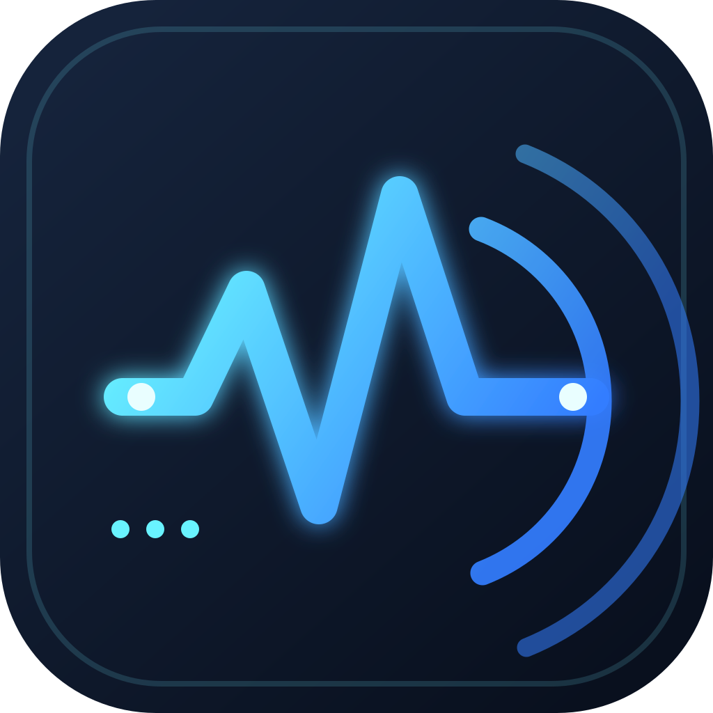

# VBAN Deck

VBAN Deck sends device audio as VBAN PCM packets to a receiver such as Voicemeeter. It supports the platforms that have working builds:

| Target | Directory | Status |
| --- | --- | --- |
| Linux / Steam Deck Flatpak | `flatpak/` | Working release source |
| Steam Deck Game Mode (Decky Loader) | `decky/` | Working plugin source |
| Android | `android/` | Working playback-capture sender |
| macOS | `VBANDeckMac/` | Native SwiftUI application |

The protocol uses 48 kHz, stereo, signed 16-bit PCM in 256-frame UDP packets. Configure the receiver with the sender's stream name and port (default `6980`).

## Repository layout

The root intentionally contains only publishable source. Build outputs, local Flatpak repositories, archives, Android build products, and editor settings are ignored.

## Build

See each platform's README:

- [Flatpak / Steam Deck Desktop](flatpak/README.md)
- [Decky Loader](decky/README.md)
- [Android APK](android/README.md)
- [macOS app](VBANDeckMac/)
- [Release guide](docs/RELEASING.md)

## Publishing to GitHub

1. Create an empty GitHub repository named `VBANDeck`.
2. Review `git status`, then commit this source tree.
3. Add the GitHub remote and push `main`.
4. Follow the [release guide](docs/RELEASING.md) to tag and publish `v0.2.1`.

The included GitHub Actions workflow builds the Android debug APK on pushes and pull requests, making a test artifact available from the workflow run.

## License

MIT. See [LICENSE](LICENSE).
